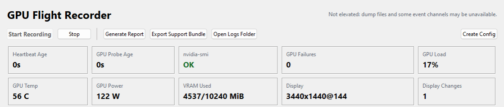

# GPU Flight Recorder

A local diagnostic recorder for Windows and NVIDIA display freezes.

I built this to keep evidence when the screen stalls: a heartbeat independent of the GPU probe, Windows events, power transitions and markers that can be compared after recovery. Public beta. Python 3.11+ with no third-party runtime dependencies.

[Quick start](#quick-start) · [Architecture](docs/architecture.md) · [Usage and privacy](docs/usage.md) · [Case study](https://alexjardinedigital.com/work/gpu)



## Quick start

Requires Windows 10 or 11 and Python 3.11+ with Tkinter. GPU readings need an NVIDIA GPU with `nvidia-smi` on `PATH`; without it, the recorder still captures the heartbeat, events, markers, power transitions and display topology.

```powershell
git clone https://github.com/Krmzyn/gpu-flight-recorder.git
cd gpu-flight-recorder
python -m pip install -e .
python -m gpu_flight_recorder
```

Click **Start Recording** and leave it running while you work. Administrator access improves coverage; the app also supports reduced coverage without elevation. Full setup and recording instructions are in the [usage guide](docs/usage.md).

## How it works

- **Independent heartbeat:** a stalled `nvidia-smi` call cannot hide whether the recorder is still alive.
- **Separate evidence streams:** append-only JSONL records hold GPU samples, probe failures, keyboard state, events, power transitions and markers.
- **Correlation after recovery:** reports bring those streams together and distinguish observations from inferred causes.
- **Local support bundles:** exports trim the evidence window and redact selected fields. Review a bundle before sharing it.

[Architecture and collector responsibilities](docs/architecture.md) · [Example report](sample_report.md)

## During a freeze

1. Press Caps Lock or Num Lock once while the screen is frozen. The keyboard-state collector can record the change.
2. After the display recovers, add the **display froze / observed** marker.
3. Add **display recovered** if recovery time is unclear.

A marker added after recovery records your observation, not the exact moment a freeze began.

## Verify locally

```powershell
python -m unittest discover -v
```

Tests cover parsers, event queries, power-event normalization, freeze classification, report generation, support-bundle export, crash recovery and the marker command, plus a GUI instantiation smoke test. The existing GitHub Actions workflow tests Python 3.11, 3.12 and 3.13 on Windows.

## Scope and privacy

This records evidence; it does not repair a driver or prove every failure's cause. It targets Windows and NVIDIA, and remains a beta.

Recording stays local, but logs can contain process details, display topology, event messages, dump filenames and typed markers. Process command-line collection is off by default. See [data handling, configuration and limitations](docs/usage.md).

## Contributing

[Contribution guide](CONTRIBUTING.md) · [Security reporting](SECURITY.md) · [MIT license](LICENSE)

Built by [Alex Jardine](https://alexjardinedigital.com), founder of [Jardine Studio](https://jardinestudio.com).
